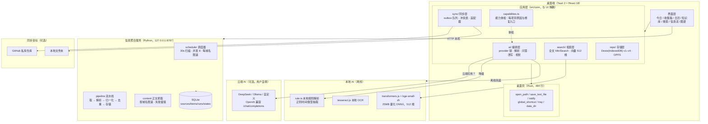
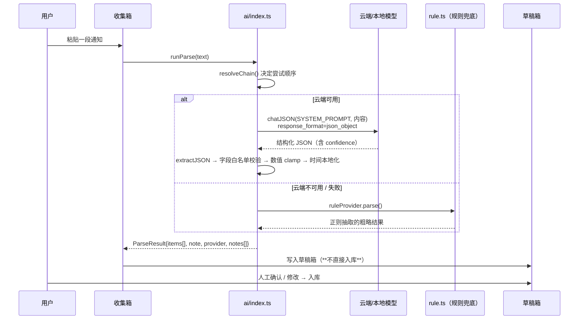
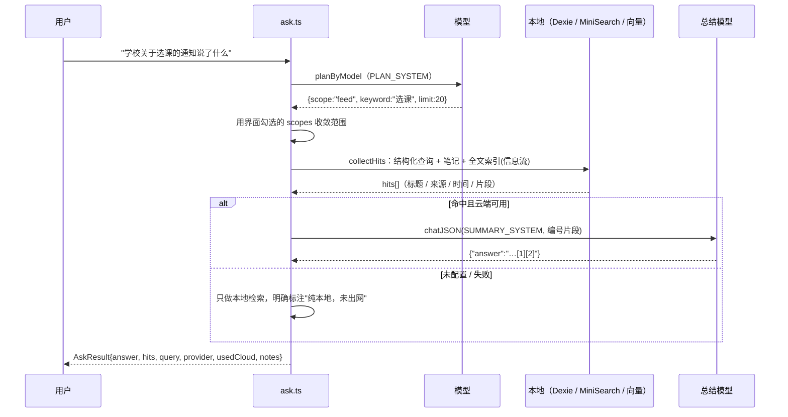

# 个人工作台 · 赛道 B（AI Application）专项材料

> 作品名：个人工作台（Personal Workspace）
> 版本：v0.2.0　|　许可：MIT　|　仓库：https://github.com/wzsl07/personal-workspace
> 定位：**本地优先、离线可用**的个人日程与知识库；AI 是可插拔的一层，不是前提。

本文件按赛道 B 的七项要求组织，逐项给出可验证的实现细节。文中所有"实测"数据均来自本机实际运行，未做修饰。

---

## 1. 场景与价值分析

### 1.1 目标用户

我把用户收敛到一类人：**信息入口很多、但没有被服务的个人**——典型是大学生、研究生、独立开发者。他们的共同特征是：

- 每天从**班级群通知、教务公告、课程群、RSS/资讯站**里被动接收几十条碎片信息；
- 这些信息的最终形态应该是**日程条目**（几月几日交作业）或**知识笔记**（某个知识点）；
- 但他们没有秘书，也没有动力为这件事开一个 SaaS 账号。

### 1.2 真实痛点（按"痛"的程度排序）

| # | 痛点 | 具体表现 |
|---|---|---|
| P1 | **碎片信息不会自动变成待办** | 群里发"下周三交实验报告"，人看到了，但要么忘了记，要么记在了三个不同的地方（微信收藏、便签、脑子里） |
| P2 | **记完之后找不到** | 三个月后想找"班费那件事"，只记得个大概意思，关键词对不上，全文搜索一无所获 |
| P3 | **现有工具要么太重要么太云** | Notion / 飞书要注册、要联网、要按年付费；手机便签又无法结构化 |
| P4 | **隐私顾虑** | 日程和笔记是个人密度最高的数据，很多人本能地不愿意交给云端 |
| P5 | **订阅源分散** | 想看学院通知要挨个打开三个网站，而它们没有一个像样的 RSS |

### 1.3 现有解决方式及其不足

| 现有方式 | 解决到哪一步 | 缺什么 |
|---|---|---|
| 日历 / 待办 App（系统日历、TickTick） | 能存结构化日程 | **录入全靠手打**；不解决 P1；搜不到"意思相近"的内容 |
| 笔记软件（Notion、Obsidian） | 能存知识、能全文搜 | 仍然要手动整理；云端版有隐私顾虑（P4）；自建同步要折腾 |
| 通用 AI 助手（ChatGPT / DeepSeek 网页版） | 能把一段话整理成条目 | **整理完还得你自己搬进日历**；它没有你的历史数据，无法回答"我上次那个班费记在哪" |
| RSS 阅读器（Feedly、Inoreader） | 能聚合订阅 | 只解决"读"，不解决"变成待办"；且多为云端服务 |

一句话概括现有方案的缺口：**"理解"和"落地"是断开的**——AI 能理解，但它落不了地；日历能落地，但它不理解。

### 1.4 Agent 带来的改进（本作品的做法）

关键区别：本作品不是"聊天框 + 日历"，而是把 **LLM 当成一个会调用工具的编排器**，让它在本地数据上闭环：

| 能力 | 传统做法 | 本作品的 Agent 做法 | 可验证的改进 |
|---|---|---|---|
| 录入 | 手打表单 | 粘贴一段自然语言 → 模型输出结构化条目 → 置信度 → 进**草稿箱**等人确认 | 实测：一段 60 字的班会通知，一次解析出 2 条条目（收班费、交报告），带时间与优先级 |
| 查找 | 关键词精确匹配 | 三种检索并存：全文（2-gram + BM25）、语义（本地向量）、问答（模型规划 + 本地执行 + 模型总结） | 实测：搜"新生入学要准备什么"（一个字都不在标题里），语义检索命中"入学体检须知""选课通知"等 6 条，相似度 51%–56% |
| 订阅 | 手动刷网页 | 常驻服务定时抓取 → 解析 → 去重 → 按栏目归类 → **自动补正文** | 实测：5 个源 75 条，其中 60 条拿到正文（RSS 全文零请求补 13 条，网页详情抓 47 条），共 8.3 万字 |
| 断网 / 无 Key | 功能直接不可用 | 云端能力全部**可降级**：模型 → 本地 Ollama → 本地规则 | 实测：未填 API Key 时问答仍返回 4 条引用，只是不做总结（界面明确标注"纯本地，未出网"） |

**价值主张**：AI 应该是"能断开的插件"。断开了，它仍然是一个可用的日程 + 知识库；接上了，它才帮你理解和检索。这条设计约束贯穿全部架构决策。

---

## 2. 系统架构设计文档

### 2.1 总体架构图



### 2.2 服务拆分与职责

| 组件 | 形态 | 职责 | 为什么要独立 |
|---|---|---|---|
| **前端 + 桌面壳** | Tauri 2（Web 前端 + Rust 壳） | 全部 UI、本地存储、检索、AI 编排 | 一个进程搞定，用户双击即用；Rust 只做 Web 做不到的事（系统通知、文件对话框、托盘、全局快捷键） |
| **信息聚合服务** | 常驻 Python 进程（FastAPI + SQLite） | 定时抓取、解析、去重、存正文、提供本机 API | **抓取需要常驻进程**——浏览器关了就不该继续抓；且绝大多数站点不给 CORS 头，前端直连必然失败。这个拆分是被现实逼出来的 |
| **向量模型** | 浏览器内 WASM（transformers.js） | 文本 → 512 维向量 | 放在前端进程内，数据不出进程；不单独起服务，避免又多一个要守护的进程 |
| **同步适配器** | 前端模块 | GitHub / 本地文件夹双向同步 | 适配器模式，`adapter: none / github / localFolder`，默认 none（即不同步） |

### 2.3 关键设计决策与理由

| 决策 | 选择 | 理由 | 代价 |
|---|---|---|---|
| **存储** | IndexedDB（Dexie），不用自研文件格式 | 事务、索引、版本迁移都是现成的；浏览器与桌面壳共用一套代码 | 数据在浏览器 profile 里，用户不易直接看到（已提供"打开数据目录"入口 + 一键 JSON 备份） |
| **桌面壳** | Tauri 2，不用 Electron | 产物 27MB（Electron 通常 80MB+）；Rust 侧仅 484 行 | 生态与踩坑资料比 Electron 少（本次就踩了命令名必须带 `_cmd` 的坑） |
| **检索** | 三套并存（全文 / 向量 / 问答）而非一套 | 三者互补：全文快而准、向量能召回同义、问答能推理并给结论；**都不是必需的**，用户可以只用全文 | 三个 UI tab + 三套索引，代码量上升 |
| **向量模型** | 浏览器内 bge-small-zh（25MB） | 数据不出进程；断网可用；无 API 成本 | 首次加载 ~1.2s；建索引 30–60ms/条；小模型语义能力弱于云端 |
| **AI 接入** | OpenAI 兼容协议 + 多 provider（DeepSeek / Ollama / 自定义） | 换模型只改地址和模型名；本地 Ollama 与云端同一套代码 | 各 provider 的细微差异要兜（如 DeepSeek 的 JSON 模式要求提示词含 "json"） |
| **聚合服务语言** | Python | feedparser / parsel / lxml 生态成熟，RSS 脏数据容忍度高 | 用户机器上要有 Python（启动脚本会自动检查并装依赖） |
| **前端零外链** | 单 HTML 内联 CSS/JS（聚合服务界面）；模型与运行时全部本地 | 断网能打开；不依赖 CDN 存活 | 产物变大（模型 24MB + wasm 21MB） |

---

## 3. Agent 执行流程

### 3.1 总体执行范式

本项目没有用一个通用 Agent 框架，而是**按场景写了三条固定的链路**（解析 / 问答 / 聚合），每条都是"规划 → 调工具 → 校验 → 落库/呈现"。选择固定链路而非开放式 ReAct 循环，理由是：个人数据场景下，**可预测比通用更重要**——你不会希望一个 Agent 自作主张地删掉你的日程。

三条链路共用同一套机制：**输出必须是 JSON → 白名单校验 → 字段兜底 → 失败降级**。

### 3.2 链路 A：收集箱解析（自然语言 → 结构化条目）



- **任务规划**：`SYSTEM_PROMPT` 明确输出 schema（type 只能是 9 种之一、priority 0–4、时间用本地 ISO、每段可能含多个事项要拆分）。
- **工具调用**：这里唯一"工具"是 LLM 本身；输出后立刻做**结构化校验**（type 不在白名单就丢弃、priority 四舍五入并 clamp、时间补成本地 ISO）。
- **上下文管理**：无状态单次调用。系统提示 + 当前本地时间 + 原文，不携带历史（避免对话膨胀与串味）。
- **状态管理**：解析结果先进**草稿箱**（`drafts` 表），人工确认后才成为正式条目。这是一道刻意的人工闸门。

### 3.3 链路 B：问答（自然语言 → 本地执行 → 带引用回答）



- **任务规划**：`PLAN_SYSTEM` 让模型输出 `scope`（schedule / feed / all）、`types`、`statuses`、`keyword`、时间范围、`limit`。
- **工具调用（本地）**：① Dexie 结构化查询（按 type/status/时间/标签）② 笔记全文子串匹配 ③ MiniSearch 全文索引（信息流，2-gram + 前缀 + 模糊）④ 可选向量检索。
- **上下文管理**：只把**命中的那几段**交给模型（不是全库），并在片段前标注 `来源=信息流 / 笔记 / 日程`，避免模型把通知当成用户的待办来答。
- **多步骤**：规划 → 检索 → 总结，共 2 次模型调用 + N 次本地检索；异常时退化为 0 次模型调用。
- **可审计**：返回体里带 `query`（实际查询条件）、`provider`、`usedCloud`、`notes`，界面上全部展示，用户可以核对"它到底按什么条件查的"。

### 3.4 链路 C：信息聚合（自治流水线，无 LLM 参与）

```
[定时触发] scheduler 每 30s 扫描到期来源（并发 8，每域名最小间隔 3s，±10% 抖动）
   ↓
[取]  手动跟随重定向（每一跳都过 SSRF 校验）· robots.txt 检查 · ETag/304
   ↓
[解析] rss / json / html(CSS 选择器) 三选一；feed 自带全文字段优先取（零额外请求）
   ↓
[归一化] 标题去标签 · 摘要截断 200 字 · 链接绝对化 · 时间统一时区
   ↓
[去重] guid → url_key → content_hash 三级判重
   ↓
[存储] SQLite；按栏目分别限条数（每栏目 500，单源 5000）
   ↓
[补正文] 后台小工：每 10 分钟一批 20 条，按域名限速 1.5s，失败记 fail 不重试
   ↓
[健康] 成功清零失败计数 / 失败退避 1m→5m→15m→1h→4h / 连续失败 5 次自动隔离
```

这条链路是"Agent"的另一个面向：**不靠模型，靠状态机**。它有时间感知（下次到期时间）、有记忆（ETag）、有自我节流（退避与隔离）、有失败留痕（fetch_runs 表）。

### 3.5 上下文与状态管理总表

| 层 | 载体 | 说明 |
|---|---|---|
| 主数据 | IndexedDB（Dexie）v1→v4 迁移 | items / notes / links / attachments / tags / vectors / feedItems / drafts / outbox / conflicts / syncLogs / meta |
| 聚合数据 | SQLite | sources / items（含 content）/ fetch_runs / item_states |
| 向量索引 | IndexedDB `vectors` 表 | 512 维 Float32Array，带内容哈希做增量 |
| 会话上下文 | 函数参数显式传递 | 不维护隐式对话历史，避免上下文膨胀与串味 |
| 凭据 | 加密存储（AES-GCM） | AI Key、同步 Token 落盘加密，内存明文 |
| 中间产物 | `drafts` 表 | AI 解析结果先落草稿，人工确认后入库 |

---

## 4. 异常处理说明

这一节是本项目的重点之一。原则是：**任何失败都必须有降级路径，且降级要在界面上说清楚，不允许"静默失败"或"按钮灰着但没解释"**。

### 4.1 工具调用失败

| 场景 | 处理 | 界面表现 |
|---|---|---|
| 云端模型不可用（无 Key / 关了开关 / 网络失败） | 降级链 `主 provider → Ollama → 本地规则` | 问答结果标注"本地规则生成查询条件（…原因）" |
| 抓取 HTTP 失败 | 记 `fetch_runs`（error_kind + message）；失败计数 +1；按退避表改下次到期时间 | 来源卡片显示健康状态与最近错误；日志页可查 |
| 抓取被 SSRF 拦截 / robots 不允许 | 记具体原因，**不重试** | 新增来源时预检就提示；抓取日志写明"robots.txt 不允许" |
| 连续失败 5 次 | 自动隔离（置 disabled），**但可逆** | 隔离的来源多一个"重试"按钮 → `reset_health()` 清零并立刻到期 |
| 本机聚合服务没启动 | 前端 1.5s 快速失败，用上次快照 | 搜索页标注"聚合服务没响应（…），显示的是上次快照"+ 快照时间 |
| 桌面原生能力调用失败 | 命令名静态体检脚本 `check-tauri-commands.mjs` 前置拦截 | 构建期报错，不依赖运行时发现 |

### 4.2 模型输出异常

| 异常 | 处理 |
|---|---|
| 返回内容带 Markdown 代码围栏 | `extractJSON()` 先剥围栏再取首尾花括号 |
| 返回的不是 JSON | 读响应体，报错带服务端原文（如"接口返回 400：Prompt must contain the word 'json'…"），而不是只报状态码 |
| 字段值非法（type 不在枚举内、priority 越界） | 白名单过滤 + `Math.min/max` clamp + 标题兜底"未命名条目" |
| 时间格式不对 | `localToISO()` 用正则兜底解析，解析不出给 null |
| 输出空的 content（JSON 模式已知概率事件） | 解析结果视为空，走规则兜底或提示用户重发 |
| **DeepSeek 的 JSON 模式硬约束** | 提示词里必须出现 "json" 字样，否则接口直接 400 —— 已把所有 JSON 提示词补上该字样（本次实测踩到并修复） |

### 4.3 超时

- HTTP：`CONNECT_TIMEOUT` / `READ_TIMEOUT` 分离；聚合服务用流式读取，避免大页面挂死。
- 前端调用本机服务：聚合客户端 1.5s 超时（`AbortController`），超时即用缓存快照，不阻塞界面。
- 语义建索引：长时间任务有进度条（已完成/总数）与阶段提示（加载模型 / 建索引），不假死。

### 4.4 重试与状态恢复

- **不重试的情况**：SSRF / robots 拒绝 / 4xx（重试无意义）；正文抓取失败记为 `fail`，不自动重试，避免反复骚扰源站。
- **可重试的情况**：网络类错误走退避表（1m→5m→15m→1h→4h）；隔离后由用户点"重试"立即恢复。
- **幂等**：插入用 `INSERT OR IGNORE` + `UNIQUE(source_id, guid)`；三级判重保证重复抓取不产生重复条目；统计新增条数用插入前后 COUNT 差值（早期用 `rowcount` 曾出现"显示新增 24 实际 15"的错误）。
- **状态恢复**：AI 解析结果进草稿箱（进程崩溃也不丢）；同步用 `outbox` 队列 + `conflicts` 冲突表，中断后可续。

### 4.5 人工介入机制

| 机制 | 作用 |
|---|---|
| **草稿箱确认** | AI 解析的结果一律不直接入库，必须人看过（改时间/改类型/删条目）才生效 |
| **能力体检**（`capabilities.ts`） | 逐项检查 AI / 语义 / 问答 / OCR / 同步 / 备份 / 信息流，**不可用必须给出一句人话原因 + 一个修复入口**，不允许灰按钮没解释 |
| **诊断包导出** | 生成纯文本诊断信息（版本、环境、能力状态），**刻意不含任何日程/笔记/正文/Key**，可安全地发给他人排查 |
| **来源重试 / 删除** | 隔离的来源可一键重试；来源可在界面内删除（不依赖打不开的浏览器） |
| **敏感正文加密** | 开启后附件正文加密，且不进向量索引（界面明确告知这个后果） |

---

## 5. Demo 与代码仓库

### 5.1 仓库

- 地址：https://github.com/wzsl07/personal-workspace （Public，MIT）
- 结构：

```
personal-workspace/
├─ personal-os/            前端 + Tauri 桌面壳（15,173 行 TS/TSX · 484 行 Rust）
│  ├─ src/core/            应用层：adapters(ai/embed/ocr/sync) · search · repo · domain
│  ├─ src/features/        界面：today · inbox · calendar · notes · search · aggregator …
│  ├─ src-tauri/           Rust 壳：命令、托盘、通知、全局快捷键
│  └─ scripts/             构建、便携版、命令名静态体检、模型/语言包下载
├─ aggregator/             信息聚合服务（5,192 行 Python + 673 行测试）
│  ├─ core/                pipeline · scheduler · health · security · robots · content
│  ├─ parsers/             rss · json · html(CSS 选择器) · auto_extract
│  └─ storage/             SQLite：db · items · sources · runs · dedup
└─ docs/                   安装指南 · 故障排查 · 同步配置 · 隐私说明 · 更新日志
```

### 5.2 依赖说明

| 部分 | 要求 | 关键依赖 |
|---|---|---|
| 前端 | Node.js 18+ | React 18、TypeScript 5、Dexie 4、MiniSearch 7、transformers.js 3、pdfjs、mammoth、tesseract.js |
| 桌面壳 | Rust 1.7x+（仅构建 exe 需要） | Tauri 2 + 通知/快捷键/对话框插件 |
| 聚合服务 | Python 3.10+ | fastapi、uvicorn、requests、feedparser、parsel、lxml、cryptography |

运行时依赖总计 17 个（前端）+ 少量 Python 包；**没有任何必须联网的依赖**——模型、运行时库、字体全部本地。

### 5.3 部署/运行步骤

```bash
# 1) 前端（浏览器版，最快看到界面）
cd personal-os && npm install && npm run dev      # http://127.0.0.1:5173

# 2) 桌面版（双击即用）
npm run tauri:build     # 产物 src-tauri/target/release，另有便携版 npm run dist:portable

# 3) 可选：语义搜索的本地模型（25MB，不随产物分发）
npm run model:setup     # 下载 bge-small-zh 到 public/models/

# 4) 可选：信息聚合服务
cd aggregator && python main.py   # http://127.0.0.1:8787，或双击 启动工作台.bat
```

### 5.4 可运行演示清单（3 分钟讲完一条主线）

1. **收集箱**：粘贴"下周三下午两点 A301 开班会，收班费每人 50 元；下周五前交物理实验报告" → 解析出 2 条草稿（含时间、优先级、置信度）→ 确认入库 → 日历上出现。
2. **搜索 · 全文**：搜"班费" → 命中那条班级事务，片段高亮。
3. **搜索 · 语义**（需先 `npm run model:setup`）：输入"新生入学要准备什么" → 命中"入学体检须知""选课通知"等（标题里没有这些词）。
4. **搜索 · 问答**：问"学校关于选课的通知说了什么" → 范围勾选收窄 → 本地检索 → 模型总结并带 `[1][2]` 引用 → 点引用跳原文。
5. **信息流**：聚合服务已在跑 → 5 个源 75 条按栏目浏览 → 点标题出 AI 摘要 → "显示原文"抽屉。
6. **断网演示**：关掉 AI 开关或拔网线 → 上述 1/2/3 依旧可用，问答降级为"纯本地，未出网"并给出原因。

---

## 6. 成本与性能分析

### 6.1 API 调用成本（按 DeepSeek 2026-08-17 起峰谷定价，deepseek-flash）

空闲时段：缓存命中输入 ¥0.05 / 百万 token，缓存未命中输入 ¥1.5，输出 ¥4.5；高峰时段翻倍。

| 动作 | 模型调用次数 | 估算 token | 单次成本（空闲时段） |
|---|---|---|---|
| 收集箱解析一段通知 | 1 | 输入 ~800（系统提示 500 + 内容）· 输出 ~300 | **≈ ¥0.0026** |
| 一次问答（规划 + 总结） | 2 | 输入 ~1500 · 输出 ~500 | **≈ ¥0.0045** |
| 查询改写（开启时） | 1 | 输入 ~300 · 输出 ~120 | ≈ ¥0.0006 |
| 信息流 AI 摘要（按需） | 1 | 输入 ~1500 · 输出 ~200 | ≈ ¥0.003 |

**典型用量**：每天 20 次解析 + 10 次问答 ≈ **¥0.1 / 天 ≈ ¥3 / 月**。关闭云端则为 **¥0**（全部走本地规则与本地向量）。

> 说明：数字是按系统提示长度与实测输入输出量级估算，非账单数据；实际随内容长度浮动。

### 6.2 端到端延迟（实测）

| 路径 | 耗时 | 备注 |
|---|---|---|
| 全文检索（数千条） | 毫秒级 | MiniSearch 纯内存索引 |
| 语义检索（索引就绪） | 毫秒级 | 向量点积，83 条线性扫描 |
| **本地向量模型首次加载** | **1,195 ms**（实测） | 含 WASM 初始化；之后常驻 |
| 语义建索引 | 30–60 ms / 条 | 83 条约 5 秒；上千条需数分钟（因此设为可选功能） |
| 问答（云端） | 2–5 s | 两次串行模型调用 + 本地检索 |
| 问答（纯本地降级） | 毫秒级 | 无模型调用 |
| 聚合服务一轮抓取 | 通常 < 2 s | 304 命中时更快（不解析不入库） |
| 补正文（62 条） | 约 2 分钟 | 每域名限速 1.5s，串行 |

### 6.3 资源消耗

| 项目 | 占用 |
|---|---|
| 桌面端安装包 | 27 MB（含 24MB 向量模型 + 21MB WASM 运行时） |
| 语义索引 | 2 KB / 条（512 维 Float32） |
| 聚合数据库 | 当前 75 条约 90 KB（含 8.3 万字正文） |
| 常驻内存 | 桌面端 ~34 MB（实测任务管理器）；聚合服务 ~50 MB |
| 网络 | 默认 0；抓取按来源间隔（最小 300s），并遵守 robots 与每域名限速 |

### 6.4 主要瓶颈

1. **语义索引构建是串行的**：逐条 `embed()`，没有批处理/并发；上千条要数分钟。（已用"可选功能 + 条数上限 2000"缓解，未根治）
2. **向量检索是线性扫描**：没有 HNSW/IVF 索引。当前量级（千条）无感，量级上万会成为瓶颈。
3. **问答两次模型调用串行**：规划必须在总结前，无法并行；可改流式输出降低"等待感"。
4. **聚合正文抓取串行 + 域名限速**：62 条要 2 分钟；可按域名并发。
5. **前端单次障的 Web Worker 缺失**：PDF 解析、向量计算都在主线程，大索引构建时界面会卡（目前用进度条掩盖）。

### 6.5 优化方向（按性价比排序）

| 优化 | 预期收益 | 代价 |
|---|---|---|
| 向量批量推理（batch=16/32） | 建索引提速 3–5 倍 | 中等（改 embedMany） |
| 索引构建搬进 Web Worker | 界面不再卡顿 | 中等（需要序列化数据） |
| 引入 HNSW（如 hnswlib-wasm） | 检索从 O(n) → O(log n) | 较大（新增依赖与索引格式） |
| 问答流式输出 | 首字延迟从 2–5s → <1s | 小（SSE 解析 + UI 增量渲染） |
| 语义索引只对新内容增量 | 已实现（内容哈希比对） | — |

---

## 7. 可观测性证据

### 7.1 抓取运行记录（聚合服务 `fetch_runs` 表）

每轮抓取写一行：`started_at / finished_at / status / http_status / duration_ms / items_found / items_new / error_kind / error_message`，界面可在来源的"日志"里按时间倒序查看，也可 `python cli.py runs` 查看。

示例（本机实测抓取轮次）：

| 来源 | 状态 | HTTP | 耗时 | 发现 | 新增 |
|---|---|---|---|---|---|
| 上海大学迎新网 | ok | 200 | 640 ms | 30 | 30 |
| 本科生院公告 | ok | 200 | 880 ms | 24 | 24 |
| 阮一峰的网络日志 | not_modified | 304 | 210 ms | — | — |
| 上大新闻网（部分路径） | error | — | — | — | — |

### 7.2 正文覆盖指标（`/api/content/status`）

```json
{"items":75,"with_content":60,"failed":15,"skipped":0,"pending":0,"content_chars":83199}
```

按来源细分（`python cli.py content --status`）：

```
条目 75　有正文 60　失败 15　跳过 0　待处理 0
  [1] 阮一峰的网络日志   rss   抓正文=关　3/3 有正文      ← feed 自带全文，零额外请求
  [4] 本科生院公告       html  抓正文=开　23/24 有正文
  [5] 上大新闻网         html  抓正文=开　3/8 有正文       ← 失败多为 robots 不允许
  [6] 少数派             rss   抓正文=关　10/10 有正文
  [7] 上海大学迎新网     html  抓正文=开　21/30 有正文
```

### 7.3 能力体检（前端 `capabilities.ts`）

每一项能力都给出"可用 / 不可用 + 人话原因 + 修复入口"，例如：

```
[可用]   AI 解析：已配置，收集箱里的文本可以一键解析成日程草稿。
[不可用] 语义搜索：本地向量模型已就位（量化版）
[可用]   信息流搜索：已镜像 75 条（今天更新）
[不可用] 数据备份：还从来没备份过。现在花 3 秒导一份   → 去备份
```

### 7.4 诊断包（可安全外发）

`设置 → 关于 → 导出诊断包` 生成纯文本，含：版本、桌面壳版本、运行环境、UA、屏幕/窗口尺寸、语言时区、数据目录、各能力状态。**明确不含**日程、笔记、附件正文、API Key、Token、仓库名（代码里写死了只输出这些字段）。

### 7.5 前端调用留痕

- 问答结果对象带 `provider / usedCloud / notes[]`，界面直接显示"查询条件由模型生成""片段已送模型总结""纯本地，未出网"等，用户随时知道这一次有没有出网。
- 抓取/补正文的每一步都有 stdout 日志（`[补正文] ✓/✗ …`），便于回溯。
- 聚合服务 `/api/status` 暴露调度器运行状态（扫描间隔、并发上限、每域名间隔）。

---

## 附：本材料的"可验证"清单

| 声称 | 怎么验 |
|---|---|
| 断网可用 | 拔网线，录入/日历/全文/语义全部照常 |
| 不上传 | 抓包或看代码：除用户自填的 AI 地址与同步仓库外无任何外发请求 |
| 三种检索都能搜信息流 | 搜索页勾选"信息流"，分别在三个 tab 用同一句话搜索 |
| 未配 Key 也能用 | 不填 API Key，问答仍返回引用并标注"纯本地，未出网" |
| 正文入库 | `python cli.py content --status` |
| 抓取不会骚扰源站 | 看 `fetch_runs` 的时间间隔与 robots 拒绝记录 |
