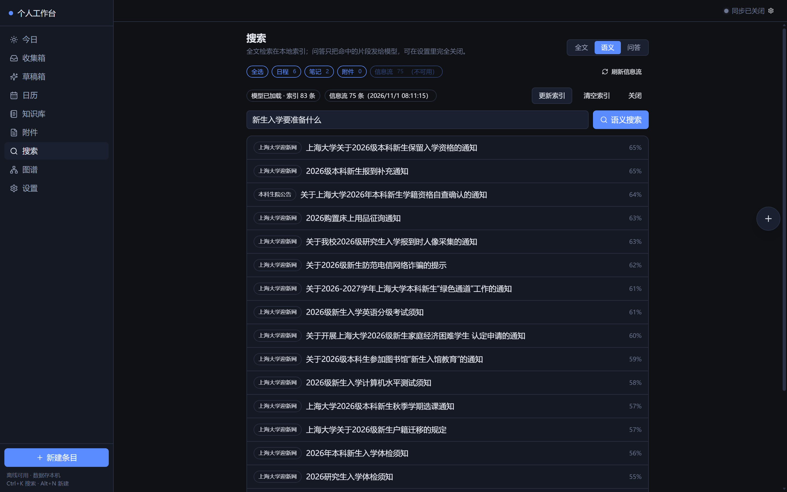
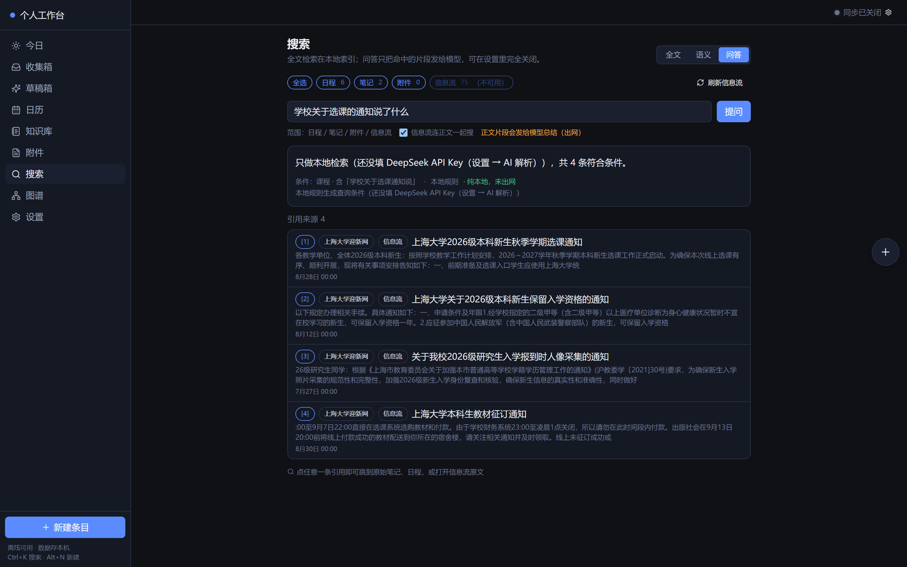

# 个人工作台

把随手写的东西，变成日程和知识 —— **并且让 AI 帮你整理、帮你找到**。

它和普通日程 / 笔记工具最大的不同在三件事：

1. **AI 真的在帮你干活**：粘贴一段班级通知，它拆成带时间和优先级的日程草稿；
   问一句"学校关于选课的通知说了什么"，它去你的数据里查完再回答，还带上引用。
2. **搜索能"按意思找"**：全文、语义、问答三种检索并存，连你订阅抓来的信息流正文都能搜。
3. **信息流自动聚合**：几个常看的网站定时抓取、按栏目归类、自动补正文，不用再挨个打开。

数据存在你自己的设备上（没有账号、没有服务器），
**AI 与同步是你要不要开、连哪家的开关** —— 想完全离线也能用，但那不是它的重点。

---

## 它解决什么问题

你每天都在这几个地方之间来回倒腾信息：

- 班级群 / 工作群里刷过去一条通知，得手动拆成"什么时候、做什么、截止到几点"
- 想记点东西，但笔记和日程是两套系统，互相找不到
- 想找"上次那个关于××的讨论"，只记得意思不记得原话，关键词怎么都对不上
- 学院通知、新闻、常看的站点要挨个打开才知道有没有更新

个人工作台把这些串成一条路：

```
随手扔进收集箱 ──AI 解析──▶ 结构化草稿 ──你确认──▶ 进日历 / 知识库
                                                    │
常看的网站 ──定时抓取──▶ 信息流（自动补正文）────────┘
                                                    │
                              全文 / 语义 / 问答 ◀───┘  ← 三种方式都能搜到上面全部内容
```

设计上有一条硬原则：**AI 只生成草稿，必须你确认后才写入正式数据。**
它不会自作主张改你的日历。

---

## 主要功能

### 收录与解析

| 功能 | 说明 |
|---|---|
| 收集箱 | 文本、链接、文件先扔进来，之后再整理 |
| AI 解析 | 一段话 → 结构化日程草稿（见下方示例） |
| 草稿箱 | 左边原文、右边可编辑字段，没把握的字段标"待确认"，逐条或批量确认 |
| 悬浮球 | `Alt+Q` 随时唤出（网页版在应用内，桌面版是真的系统级小窗），带迷你月历 |
| 附件 | PDF / Word / 图片 / txt 拖进来，抽文字 → 进收集箱 → 走同一条解析流程 |

9 种条目类型：**任务、待办、作业、课程、班级事务、活动、考试、会议、自定义**。
状态：未开始 / 进行中 / 已完成 / 已延期 / 已取消。

### 组织与查看

- **今日**：逾期 / 今天 / 未来 7 天 / 无期限 四段
- **日历**：月 / 周 / 日视图，可按类型筛选，点空白格直接新建
- **知识库**：Markdown 笔记，`[[标题]]` 双链，自动生成反向链接
- **图谱**：笔记 / 日程 / 标签为节点，双链与关联为边，力导向布局，可缩放拖拽
- **提醒**：准点 / 提前 10 分钟 / 30 分钟 / 1 天；重复条目触发后自动算下一次

### 检索（三种，各有用处 —— 这是最实用的部分）

| 方式 | 原理 | 适合什么时候用 | 联网 |
|---|---|---|---|
| **全文** | MiniSearch + 中文 2-gram；命中太少时自动放宽为 OR | 记得关键词，想最快看到结果 | 否 |
| **语义** | 本地向量模型 `bge-small-zh`（512 维），离线算 | 忘了原话、只记得个大概意思 | 否（可选功能，默认关） |
| **问答** | 模型生成查询条件 → 本地执行 → 模型总结，带 `[1][2]` 引用 | 想直接要一个答案，而不是一堆结果 | 需要填 Key |

三种不是替代关系，是**上下游**：问答的召回质量取决于本地检索，而语义检索补的正是
"字面不同但意思相近"这一段。

**搜索范围**：日程 / 笔记 / 附件 / 信息流，四个勾选项，三个 tab 共用。
默认只勾日程 + 笔记 —— 想搜信息流时自己勾上，这样问"还有什么没做"不会冒出一条校园新闻。

**信息流也要能搜到正文**：订阅抓来的通知和文章一样进索引，而且搜的是正文不是标题。
实测：5 个源 75 条，其中 60 条拿到正文（8.3 万字），搜"选课"能直接命中通知正文里的安排。

**智能改写**（默认关）：开启后让模型把你的问法扩成 6–10 个同义词再检索，
适合"想不起用词"的场景，联网但只发送你的问题，不上传正文。

语义搜索需要先下载一次模型：

```bash
npm run model:setup     # bge-small-zh，约 25MB，下载后永久离线可用
```

实测（本机 83 条索引）：模型首次加载 **1.2 秒**，之后检索毫秒级；
搜"新生入学要准备什么"（标题里没有这些词）能命中入学体检须知、选课通知等，相似度 51%–56%。



问答只把**命中的那几段**发给模型，绝不上传全库；关掉云端后查询条件改用本地规则生成，
一点不出网（界面会明确标注"纯本地，未出网"）。



### 信息流（订阅 → 定时抓取 → 能按意思搜正文）

它是**一个常驻的本地服务**（Python，`127.0.0.1:8787`）+ 应用里的一个页面：

| 能力 | 说明 |
|---|---|
| 来源类型 | RSS / Atom、JSON Feed、网页（CSS 选择器，多栏目） |
| 自动探测 | 粘贴网址 → 自动判断类型并生成解析规则 → 直接保存（也可以手调） |
| 定时抓取 | 每 30 秒扫描到期来源，并发 8，**每域名最小间隔 3 秒**，带 ±10% 抖动 |
| 省流量 | ETag / Last-Modified：304 直接跳过解析与入库 |
| 栏目分类 | 一个页面里"通知公告 / 新闻动态 / 学术活动"分列，各栏目分别限条数 |
| **正文入库** | RSS 直接取 feed 自带全文（**零额外请求**）；网页源按域名限速抓详情页 |
| AI 摘要 | 点标题就地展开摘要（走你配的 AI）；「显示原文」在右侧抽屉里渲染清洗过的正文 |
| 合规 | 抓取前查 robots.txt、逐跳 SSRF 校验、凭据 AES-GCM 加密存储 |
| 健康检查 | 失败退避 1m→5m→15m→1h→4h；连续失败 5 次**自动隔离**，但可一键"重试"恢复 |
| 一键启动 | 应用里点「启动聚合服务」；也可双击 `启动工作台.bat`，或把 `.vbs` 放进开机启动项 |

```bash
cd aggregator
python main.py                 # http://127.0.0.1:8787，会自动打开浏览器
python cli.py content --status  # 看正文覆盖情况
python cli.py content           # 补抓正文（先 feed 自带全文，再抓网页详情）
```

实测数据（5 个源：上大迎新网 / 本科生院 / 上大新闻网 / 阮一峰 / 少数派）：

```
条目 75　有正文 60　失败 15　跳过 0　待处理 0
  [1] 阮一峰的网络日志   rss   抓正文=关　3/3 有正文      ← feed 自带全文，零额外请求
  [4] 本科生院公告       html  抓正文=开　23/24 有正文
  [5] 上大新闻网         html  抓正文=开　3/8 有正文       ← 失败多为 robots.txt 不允许
  [6] 少数派              rss   抓正文=关　10/10 有正文
  [7] 上海大学迎新网      html  抓正文=开　21/30 有正文
```

> 信息流读取的是本机的服务，所以**只有桌面版用得到**（手机访问不到你电脑的 127.0.0.1）。
> 网页版里这一项会自动置灰并说明原因。

### 同步（可选）

默认关闭。四种适配器，任选其一：

| 适配器 | 需要什么 | 备注 |
|---|---|---|
| **本地文件夹** | Chrome / Edge 桌面版 | 读写磁盘上一个 JSON，**不联网、不需要服务器**，最省事 |
| WebDAV | 坚果云 / 群晖 / Nextcloud | 服务端需允许 CORS |
| GitHub 仓库 | Personal Access Token | 在**你的私有仓库**里存一个 JSON |
| Supabase | URL + Key | 需先建 `snapshots` 表（UI 里有建表 SQL） |

冲突用**三路合并**（本地 / 远端 / 上次同步基线）：
只有一边变了就自动推或拉；**两边都变了就报冲突，绝不自动覆盖**，
给你四个选择：保留本地 / 保留远端 / 两份都留 / 稍后手动改。

### 桌面版（Windows）

Tauri 2 桌面壳，比网页版多四件事：**真正的系统级悬浮小窗**、可选全局热键、
系统托盘与原生通知（关窗也弹）、**原生文件对话框**（导出直接存盘）。
安装包为当前用户级，**不需要管理员权限**。

---

## 安装

### 方式一：直接用网页版（最省事）

浏览器打开已部署的地址即可，可「添加到主屏幕」当 App 用。
数据存在**该浏览器的该用户**里，换浏览器看到的是另一份空数据。

### 方式二：从源码跑（推荐，功能最全）

需要 Node.js 18+。

```bash
git clone <本仓库地址>
cd personal-os
npm install
npm run dev          # 开发服务器 http://127.0.0.1:5173
```

> 仓库里带了一个 `.npmrc`，把 npm 源指向国内镜像以加快安装。
> **这是可选的** —— 你在国外、或直连官方源就很快的话，删掉它即可，不影响任何功能。
> （它会影响 `package-lock.json` 里记录的下包地址，换源后 lock 也会跟着变，属正常现象。）

想用语义搜索，再跑一次（只需一次）：

```bash
npm run model:setup  # 下载中文向量模型到 public/models/（国内镜像优先，自动回退官方源）
```

图片 OCR 有两条路，默认**云端优先、失败自动退回本机**：

| | 云端视觉模型 | 本机 tesseract |
|---|---|---|
| 速度 | 3~10 秒 | 电脑 3~5 秒，手机 30 秒起 |
| 准确率 | 截图、课件照片、手写都更准 | 正常字号很准，小于 12px 的小字容易串行 |
| 联网 | 需要 | **不需要** |
| 隐私 | 图片发给服务商 | 图片不出设备 |
| 成本 | 约 0.003~0.01 元/张 | 0 |

要用本机这条路，先跑一次（可选，共约 14MB）：

```bash
npm run ocr:setup    # 复制 worker/wasm，并下载 chi_sim、eng 语言包（约 6.6MB）到 public/ocr/
```

不介意图片离开本机就把「识别方式」保持默认的「自动」；
介意就改成「只用本机」。缺语言包时识别会直接说明缺哪个文件，不会偷偷联网下载。

云端用的是你在「AI 解析」里填的服务商。**DeepSeek 请填 `deepseek-flash`**
（`deepseek-chat` 只吃文本，不支持图片）。

构建：

```bash
npm run build        # 类型检查 + 构建到 dist/，产物零外链，可整目录拷走
npm run preview      # 预览构建产物
npm run build:mobile # 手机版：去掉 45MB 的模型和运行时，产物约 2.6MB
```

### 方式三：打包桌面应用（需 Rust）

```bash
npm install -D @tauri-apps/cli@^2
npm run tauri:dev    # 开发
npm run tauri:build  # 产出 NSIS 安装包 + 便携版 exe
```

需要 Rust 工具链（rustup）和 Visual Studio Build Tools（勾选「使用 C++ 的桌面开发」）。
详见 [`src-tauri/README.md`](src-tauri/README.md)。

> Windows 上若遇到 `os error 4551`，是**智能应用控制（Smart App Control）**拦截了未签名的
> 编译脚本。它没有"允许一次"的选项，只能在 Windows 安全中心里关掉（**不可逆**），
> 或者换一台已关闭 SAC 的机器编译。

---

## 使用方法

### 第一次打开

会有 4 步引导（**随时可跳过**）：

1. 说明数据存在哪
2. 选模式：纯离线（推荐）/ 接 AI / 开同步
3. 若选 AI：填 API Key
4. 若选同步：引导到设置页

跳过后随时可以在 `设置 → 一键体检` 里补上 —— 它会逐条列出
哪些功能还没启用、**为什么用不了**、以及修复入口。

### 日常流程

```
看到一条通知
  → Alt+Q 唤出浮球，粘贴进去
  → 点「AI 解析」
  → 草稿箱里核对（没把握的字段已标黄）
  → 确认 → 进日历
```

也可以手动新建：`Alt+N` 或侧边栏「新建条目」。
全局搜索 `Ctrl/⌘+K`。

### 一定要做的事

**定期备份。** `设置 → 数据 → 一键备份（JSON）`。

数据只有本地这一份，没有云端副本，硬盘坏了就是真没了。
恢复时可选「合并」（并入现有数据）或「覆盖」（换机器 / 重装时用）。

**API Key 不会随备份迁移** —— 这是刻意的，换机器后重新填一次。

---

## 输入输出示例

### 例 1：一段话 → 结构化日程

**输入**（收集箱里粘贴一句，或点「AI 解析」）：

```
下周三下午三点在 A301 开组会，讨论期末项目分工，提前一天提醒我
```

**输出**（先生成草稿，**不会**直接写入日历）：

```json
{
  "title": "开组会：讨论期末项目分工",
  "type": "meeting",
  "startAt": "2026-10-21T15:00:00+08:00",
  "dueAt": null,
  "allDay": false,
  "priority": 2,
  "status": "notStarted",
  "tags": ["项目"],
  "location": "A301",
  "summary": "讨论期末项目分工",
  "recurrence": null,
  "confidence": { "title": 0.92, "startAt": 0.88, "priority": 0.6 }
}
```

（`priority` 是 `0~4` 的整数；`confidence` 只对 title / type / startAt / dueAt / priority / tags 给出。）

提醒会自动设为「提前 1 天」。你在草稿箱里确认或修改后才写入正式数据。

**没填 API Key 也能用** —— 会自动降级到内置规则解析器，能识别：

> 今天 / 明天 / 后天 / 昨天、下周三、本周三、10月15日、11/3、月底、周末、
> 上午9点、下午3点半、晚上7点、23:59

并按上下文判断是「开始」还是「截止」（`…前交` → 截止）。
规则解析器置信度上限 0.75，所以字段多半会标成"待确认"，这是故意的。

**解析链**：DeepSeek → Ollama（本地）→ 内置规则，谁可用用谁，失败自动降级。
一次最多拆 6 条。

### 例 2：导出备份

`设置 → 数据 → 一键备份（JSON）`，得到：

```json
{
  "format": "personal-os-snapshot",
  "version": 1,
  "exportedAt": "2026-10-17T09:30:00.000Z",
  "items": [
    {
      "id": "itm_xxx",
      "type": "meeting",
      "title": "开组会：讨论期末项目分工",
      "startAt": "2026-10-21T15:00:00+08:00",
      "dueAt": null,
      "allDay": false,
      "priority": 2,
      "status": "notStarted",
      "tags": ["tag_xxx"],
      "noteIds": [],
      "attachmentIds": [],
      "reminderIds": ["rem_xxx"],
      "location": "A301",
      "remark": "讨论期末项目分工",
      "origin": "ai",
      "confidence": { "title": 0.92, "startAt": 0.88 },
      "rev": 1,
      "createdAt": "2026-10-17T09:28:00.000Z",
      "updatedAt": "2026-10-17T09:28:00.000Z",
      "deletedAt": null
    }
  ],
  "notes": [],
  "tags": [],
  "links": [],
  "sources": [],
  "reminders": [],
  "attachments": [],
  "drafts": [],
  "aiJobs": []
}
```

这就是同步时在网络上传输的那份东西 —— 一份全量快照，没有别的。

另有 `导出 Markdown`（给人看）和 `导出日历 ICS`（导入系统日历）。

### 例 3：按意思搜

**输入**：`下周要交的东西`

全文搜索会漏掉"交"字没出现的条目，语义搜索能命中"作业 / 截止日期在下周"的条目，
按余弦相似度排序并显示百分比。

### 例 4：问答

**输入**：`我这周还有什么作业没交？`

**输出**：

> 还有 2 项未完成：
> 1. 大学物理实验报告 —— 截止 10 月 18 日 23:59 `[1]`
> 2. 工程图学 作业四 —— 截止 10 月 19 日 `[2]`

回答下方会显示实际执行的查询条件，方便你发现它理解错了。
点引用跳转原文。

---

## 数据与隐私

| 问题 | 答案 |
|---|---|
| 数据存在哪 | 浏览器 IndexedDB；桌面版在 `%LOCALAPPDATA%\com.github.wzsl07.personal-os\` |
| 会不会上传 | 默认不会。只有你主动开启 AI 或同步才会联网，且直连你自己的服务 |
| 有统计上报吗 | 没有 |
| API Key 怎么存 | AES-GCM 加密存本机，可选口令模式（重启需重输） |
| 敏感正文能加密吗 | 可以（可选），代价是加密的正文**不进索引、搜不到** |
| 卸载会删数据吗 | 不会。想彻底清除请手动删数据目录 |

诚实说明两点：

1. 浏览器里做不到真正的整库静态加密（全量加密就没法查询）。
   本机加密防的是"随手翻文件看到明文"，**防不住能读你数据库的本机恶意程序**。
2. 没买代码签名证书，所以 Windows 会警告未签名的安装包。这不是病毒。
   蓝框点「更多信息 → 仍要运行」；被智能应用控制拦截就改用便携版。

---

## 技术栈

| 层 | 选型 |
|---|---|
| 界面 | React 18 + TypeScript + Vite + Tailwind |
| 数据 | Dexie（IndexedDB），15 张表，软删除 + `rev` 修订号 |
| 状态 | Zustand（仅 UI 状态） |
| 全文检索 | MiniSearch（中文 2-gram） |
| 语义检索 | transformers.js + onnxruntime-web + bge-small-zh，**全本地** |
| 文档解析 | pdf.js（PDF）、mammoth（docx）、tesseract.js（OCR） |
| 桌面壳 | Tauri 2 |
| 加密 | WebCrypto（AES-GCM + PBKDF2），零依赖 |

**零外链**：构建产物不引用任何 CDN、远程字体或远程脚本，断网可跑。

### 目录结构

```
src/
├─ core/
│  ├─ domain/    类型、状态机、时间工具、中文时间解析（纯函数，可单测）
│  ├─ repo/      Dexie 库定义 + 各实体仓储
│  ├─ adapters/  ai/ ocr/ crypto/ sync/ embed/ storage/ desktop/
│  ├─ aggregator/ 信息流客户端：拉取本机聚合服务的条目并镜像进本地库（供搜索）
│  ├─ io/        JSON / Markdown / ICS 导出与恢复
│  ├─ search/    全文索引 + 向量索引
│  ├─ sync/      三路合并计划与执行引擎
│  └─ capabilities.ts  能力门面：统一回答"这功能现在能用吗、为什么"
├─ features/     today / inbox / drafts / calendar / notes / attachments
│                / search / graph / settings / quick / sync / aggregator / onboarding
├─ ui/           图标映射与基础组件
└─ app/          Zustand UI 状态
scripts/         构建、发布、体检、单测脚本
src-tauri/       Tauri 桌面壳（Rust）
```

设计上把**纯逻辑与副作用分开**，方便单测：

```bash
npx esbuild scripts/test-sync.ts  --bundle --platform=node --format=esm --outfile=/tmp/s.mjs && node /tmp/s.mjs
npx esbuild scripts/test-tags.ts  --bundle --platform=node --format=esm --outfile=/tmp/t.mjs && node /tmp/t.mjs
npx esbuild scripts/test-dedupe.ts --bundle --platform=node --format=esm --outfile=/tmp/d.mjs && node /tmp/d.mjs
```

### 发布相关

```bash
npm run version:sync    # 版本号单一真相源：package.json → tauri.conf.json / Cargo.toml / version.ts
npm run dist:check      # 发布前体检：扫密钥、Token、个人路径
npm run dist:portable   # 生成便携版 ZIP
npm run release         # 生成 SHA256 / latest.json / 发布说明
```

`dist:check` 依赖两个环境变量，不设则跳过对应规则：

```bash
DIST_AUTHOR_USER=你的用户名 DIST_AUTHOR_GITHUB=你的GitHub名 npm run dist:check
```

---

## 已知限制

说在前面，免得踩坑：

1. **浏览器没有后台常驻**：自动同步和提醒只在页面打开时执行（每 30 秒轮询一次）。
   装了桌面壳后由系统常驻进程发出，关窗也弹。
2. **同步是全量快照**，不是逐条增量。几千条内够用，体积大了会慢。
3. **附件二进制不同步**，只同步元数据和抽取出的文字。
4. **手机端没有语义搜索**（22MB 模型跑不动），只有全文搜索。
5. PDF 抽取最多 50 页；扫描版 PDF（整页是图片）抽不出文字，需要开 OCR。
6. 老式 `.doc` 不支持，请先另存为 `.docx`。
   本机识别用的是 tessdata_fast 语言包，正常字号的中英文很准，
   小于 12px 的界面小字容易串行（这种情况改用云端识别会好很多）。
7. 重复规则只做基础版：每天 / 每周（可选周几），**未做**单双周与教学周次。
8. 浏览器直连 DeepSeek 可能被 CORS 拦截 —— 改用「自定义 API」指向自己的代理，
   或用桌面版（Tauri 无此限制）。Ollama 需设 `OLLAMA_ORIGINS=*`。
9. 中文搜索用 2-gram：长句匹配不错，单字查询（如"数"）召回一般 —— 用语义搜索补。

### 几个踩过的坑（别再踩）

- 判断"文件是否存在"**不能只看状态码**（SPA 兜底会返回 200 + HTML），
  也**不能依赖 HEAD 的 content-length**（Tauri 协议不给）。
  本项目用 `Range` 取前 64 字节判断真伪。
- 不要用 `disabled={功能是否可用}` 去控制输入框，用户会以为键盘坏了。
- 桌面壳里 `Blob + <a download>` **点了毫无反应** —— WebView 的下载事件需要宿主接管。
  桌面端已改走原生「另存为」对话框。
- Windows 上 WebView2 的数据目录在 `LocalAppData` 下，**不是** `app_data_dir`（Roaming）。
- transformers.js 在 Vite 下要绕四层坑，都记在 `src/core/adapters/embed.ts` 的注释里。

---

## 许可

MIT，见仓库根目录的 [`LICENSE`](../LICENSE)。
第三方依赖许可见 [`../docs/THIRD-PARTY-NOTICES.md`](../docs/THIRD-PARTY-NOTICES.md)。
隐私说明见 [`../docs/PRIVACY.md`](../docs/PRIVACY.md)。
